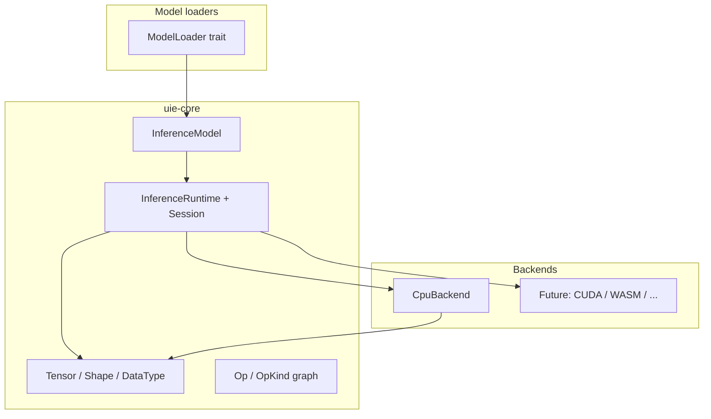

# spiro → Universal Inference Engine (UIE)

This repository began as a small Python Spirograph generator (`spiro.py`). It is being evolved into a **universal inference engine** written in Rust, with the original drawing retained as a reference workload.

**Mandate:** build a **good inference engine at any scale**, with emphasis on
**edge and embedded compute** — in-browser / embedded WASM, Raspberry Pi–class
ARM boards, and other tight-resource hosts — while still supporting larger
desktop and server backends when they share the same engine story.
See [`docs/mandate.md`](./docs/mandate.md).

**Documentation:** user stories, [acceptance tests](./docs/acceptance-tests.md), and a glossary live in [`docs/`](./docs/README.md).

## Current layout

| Path | Role |
|------|------|
| `spiro.py` | Original PIL-based spirograph script |
| `crates/uie-core` | Core engine: tensors, backends, runtime, model traits |
| `crates/uie-spiro` | Rust port of the spiro workload + demo binary |
| `crates/uie-ipc` | Byte-channel protocol + in-process / Unix transports |
| `crates/uie-serve` | Long-running inference on a Unix domain socket |
| `python/uie_client.py` | Minimal Python client for the socket API |
| `crates/uie-loader-gguf` | US-010: GGUF text completions (LM Studio weights) |
| `crates/uie-llm` | CLI: `list-gguf`, `--prompt` completion |
| `Cargo.toml` | Rust workspace root |

## Quick start (Rust demo)

```bash
cargo run -p uie-spiro
```

Writes `output.jpg` (same 2048×2048 artwork as the Python script).

## Inference byte channel (IPC)

Run a socket engine and call it from Python (stubs today; ONNX when the loader crate builds):

```bash
cargo run -p uie-serve
python3 python/uie_client.py --stub llm
```

In-process tests use the same framing via `InProcessChannel` (`cargo test -p uie-ipc`). See [US-020](docs/stories/020-inference-byte-channel.md).

## Text completion (LM Studio GGUF)

```bash
./scripts/build-gguf.sh
cp config/model_roots.example.yaml config/model_roots.yaml   # if needed
cargo run -p uie-llm -- list-gguf
cargo run -p uie-llm -- --model "$UIE_GGUF_MODEL" --prompt "Hello"
```

See [US-010](docs/stories/010-llm-text-completions.md).

## Acceptance tests (per user story)

```bash
./scripts/acceptance-ci.sh          # stub mode (CI default)
./scripts/acceptance-live.sh        # real models on your machine
```

Agents and contributors: follow [.cursor/skills/uie-user-stories/SKILL.md](.cursor/skills/uie-user-stories/SKILL.md).

## Architecture (scaffold)



### Next steps

1. **Real model loaders** — ONNX / SafeTensors / GGUF implementing `ModelLoader`.
2. **Graph executor** — wire `Session` I/O to `Backend::execute` for each `Op` in `ExecutionPlan`.
3. **Backend plugins** — dynamic registration (`BackendRegistry`) and optional `uie-backend-*` crates.
4. **Python bridge** — optional PyO3 crate wrapping `uie-core` so `spiro.py` can call the Rust runtime.