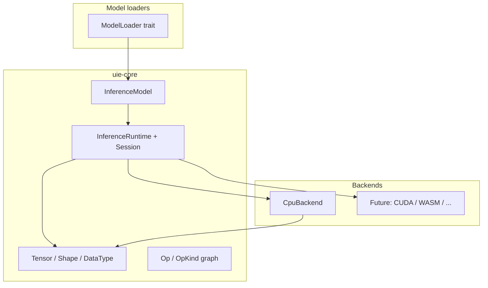

# spiro → Universal Inference Engine (UIE)

This repository began as a small Python Spirograph generator (`spiro.py`). It is being evolved into a **universal inference engine** written in Rust, with the original drawing retained as a reference workload.

**Documentation:** user stories and a shared glossary live in [`docs/`](./docs/README.md) (`US-001` … `US-009`).

## Current layout

| Path | Role |
|------|------|
| `spiro.py` | Original PIL-based spirograph script |
| `crates/uie-core` | Core engine: tensors, backends, runtime, model traits |
| `crates/uie-spiro` | Rust port of the spiro workload + demo binary |
| `Cargo.toml` | Rust workspace root |

## Quick start (Rust demo)

```bash
cargo run -p uie-spiro
```

Writes `output.jpg` (same 2048×2048 artwork as the Python script).

## Architecture (scaffold)



### Next steps

1. **Real model loaders** — ONNX / SafeTensors / GGUF implementing `ModelLoader`.
2. **Graph executor** — wire `Session` I/O to `Backend::execute` for each `Op` in `ExecutionPlan`.
3. **Backend plugins** — dynamic registration (`BackendRegistry`) and optional `uie-backend-*` crates.
4. **Python bridge** — optional PyO3 crate wrapping `uie-core` so `spiro.py` can call the Rust runtime.